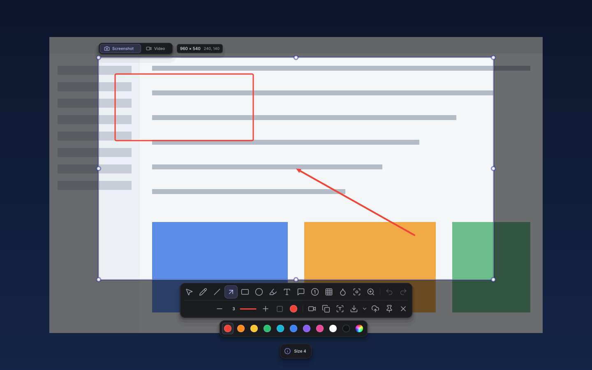
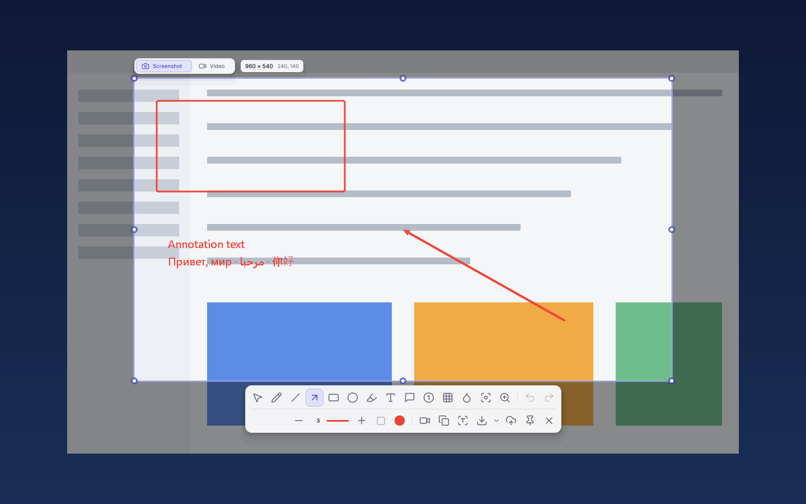

# Rustshot

A fast, tiny screenshot and annotation tool for **Windows, macOS and Linux**,
modelled on [Flameshot](https://flameshot.org) and written in Rust.

Press a hotkey, drag a region, annotate it, and copy, save or upload it.
The whole app is a single native binary under 1 MB with no runtime and no GUI
toolkit: every pixel of the overlay is drawn by Rustshot's own anti-aliased
renderer.



| Light theme | Color palette | Text tool |
|---|---|---|
|  |  |  |

## Features

- **Region capture** with resize handles, arrow-key nudging, and a live
  `W × H` size readout.
- **Window snapping:** the window under the pointer is outlined with its
  size; a click selects exactly that window (or menu, or tooltip), and
  <kbd>Tab</kbd> steps into its parts (panels, toolbars, fields).
- **Annotation tools:** pencil, line, arrow, rectangle, ellipse, highlighter,
  text, pixelate and invert, with Shift constraints (squares, circles, 45°
  lines) and unlimited undo/redo.
- **Export:** copy to the clipboard, save as PNG, JPEG or BMP straight into
  a dated folder (or through the native save dialog), or upload to imgur
  with the link copied for you.
- **Pin to screen** (<kbd>Ctrl</kbd>+<kbd>P</kbd>): the selection stays on
  top where it was, to zoom, fade and compare ([Pins](#pins-and-the-thumbnail)),
  and a **thumbnail** after each capture to copy, save, pin or drag it out.
- **History and re-editing:** every capture is kept (30 days, up to 2 GB)
  with its annotations still editable; <kbd>Win</kbd>+<kbd>Shift</kbd>+<kbd>H</kbd>
  opens the History window, and **Edit** reopens a capture in a zoomable
  window with the overlay's tools ([History](#history-and-the-edit-window)).
- **Copy text from an area** (OCR): <kbd>O</kbd> in the overlay, or
  <kbd>Win</kbd>+<kbd>Shift</kbd>+<kbd>Z</kbd> to pick an area and copy its
  text at once ([Copy text](#copy-text-ocr)).
- **Screen recording** of a region or a screen to MP4 or GIF, with system
  sound, the microphone and an on-screen camera bubble
  ([Recording](#recording)).
- **Settings window** for the theme and accent, hotkeys, saving,
  recording, uploads and every editor shortcut (no need to edit
  `config.toml` by hand).
- **Modern overlay UI:** dark and light themes that follow your OS, a grouped
  toolbar that wraps and repositions near screen edges, tooltips with the real
  shortcuts, and short animations.
- **Multi-monitor aware:** spans all monitors when they share a scale factor;
  the toolbar and notices stay on the monitor you're working on.
- **Global hotkey daemon** (capture a region with <kbd>Win</kbd>+<kbd>Shift</kbd>+<kbd>X</kbd>,
  the full screen, a window, a recording, or the last region again; see
  [Global hotkeys](#global-hotkeys)).
- **Scriptable CLI** for headless captures (`rustshot full --clip`,
  `--region`, `--raw` to stdout, `--upload`, delays).
- **In-app updates** for direct downloads: download, verify and restart
  from one dialog (store installs update themselves).

## Install

Download the latest build from
**[GitHub Releases](https://github.com/nappsllc/rustshot/releases/latest)**:

| Platform | File | Notes |
|---|---|---|
| Windows 10/11 | `rustshot-<v>-setup.exe` | Per-user installer, no admin needed; optional desktop shortcut and start-with-Windows. |
| Windows (portable) | `rustshot-<v>-windows-x86_64.exe` | Single executable. |
| macOS 11+ | `rustshot-<v>-macos-universal.dmg` | Universal (Apple Silicon + Intel). Drag to Applications. |
| Debian / Ubuntu | `rustshot-<v>-amd64.deb` | `sudo apt install ./rustshot-<v>-amd64.deb` |
| Any Linux | `rustshot-<v>-x86_64.AppImage` | `chmod +x` and run. |
| Any Linux | `rustshot.flatpak` | `flatpak install --user rustshot.flatpak` |
| Any Linux | `rustshot_<v>_amd64.snap` | `sudo snap install --dangerous rustshot_<v>_amd64.snap` |
| Any Linux | `rustshot-<v>-linux-x86_64.tar.gz` | Binary + desktop file; see `INSTALL.txt` inside. |

Store and package-manager listings (Microsoft Store, winget, Mac App Store,
Homebrew, Flathub, Snap Store, AUR) are being set up; see
[docs/STORES.md](docs/STORES.md).

> **Unsigned builds.** Current releases are not code-signed yet. Windows
> SmartScreen may warn on first run (More info › Run anyway); on macOS,
> right-click the app › Open the first time.

## Usage

Start the background daemon once (the installers can do this at login):

```bash
rustshot          # or `rustshot daemon`
```

Launching Rustshot again while it is running triggers a capture in the running
instance instead of starting a second one.

Then press <kbd>Shift</kbd>+<kbd>Meta</kbd>+<kbd>X</kbd> (Meta is <kbd>Win</kbd> on
Windows, <kbd>Super</kbd> on Linux, <kbd>⌘</kbd> on macOS) to capture. Quit the daemon with
<kbd>Ctrl</kbd>+<kbd>Alt</kbd>+<kbd>Shift</kbd>+<kbd>Q</kbd>.

Or capture directly from a terminal:

```bash
rustshot                          # start the background daemon (tray icon; default)
rustshot gui                      # interactive capture
rustshot gui --clip               # select, annotate, Enter copies to clipboard
rustshot full --path ~/Pictures   # whole desktop, no editor
rustshot screen -n 1 --edit       # second monitor, open the editor
rustshot gui --region 800x600+100+100 --upload
rustshot gui --accept-on-select   # drag a region: copied at once (Shift on release to adjust)
rustshot full --raw > shot.png    # PNG bytes to stdout
rustshot update                   # check for a newer release
rustshot settings                 # open the Settings window
rustshot history                  # open the History window (captures kept; Edit)
rustshot history --list           # print them: captured, kind, WxH, bytes, file (tab-separated)
rustshot launcher                 # the capture launcher: what, after a delay, then what
rustshot register-screenclip on   # Windows: Win+Shift+S opens Rustshot (off undoes it)
rustshot --help
```

### Settings

Open **Settings…** from the tray menu, or run `rustshot settings`
(a running daemon opens its window; otherwise the window opens on its own;
where there is no tray icon, this is the way in). On
Linux the Settings window is *(experimental)*. A rail on the left picks the
section:

- **General:** theme (System follows the OS, Dark, Light) and accent
  (Periwinkle, Teal, Amber or any `#rrggbb`: the custom swatch; the window
  previews it before **Apply**), *Launch at login* (hidden for store
  installs), *Show icon in tray* (off, the daemon runs without an
  icon: the hotkeys and a second `rustshot` launch still capture, and the
  row warns when no capture hotkey is set), *Copy to clipboard after
  capture* (a save or upload also copies the image), *Play shutter
  sound*, *Show thumbnail after capture* (see
  [Pins and the thumbnail](#pins-and-the-thumbnail)), *Show hints in the
  overlay* (the key card when it opens), *Save to* (with **Change…**) and
  the file name with an example and PNG / JPG.
- **Capture:** daily subfolders and their pattern, *Ask where to save*,
  the format (PNG, JPG or BMP) and JPEG quality, the file-name pattern
  editor (see [Saving](#saving)), the overlay's UI size (Auto follows each
  display's scaling; 75-200 % on top of it), *Snap to windows*, *Show
  magnifier* and *Square magnifier*, *Accept on select* (Off, Copy, Save;
  see [Selecting](#selecting)), *Use
  Win+Shift+S and Print Screen* (Windows: see
  [Win+Shift+S and Print Screen](#winshifts-and-print-screen-windows)), the
  renderer (Windows) and *Reset tool sizes & colors*.
- **Recording:** what video mode's panel starts with: format (MP4 or
  GIF), frame rate (MP4 30 or 60, GIF 10, 15 or 24 fps), MP4 quality, a
  GIF's max length (15, 30 or 60 s), the 3-2-1 countdown, system sound,
  microphone and its device, the camera bubble (camera, shape, size 120,
  160, 200 or 240 px, mirror, ring color and width); on Linux also the MP4 encoder (Auto,
  ffmpeg or OpenH264) with what is installed ("ffmpeg found at
  /usr/bin/ffmpeg", "OpenH264 downloaded", or not available).
- **Key bindings:** the global hotkeys, every editor shortcut (see
  below) and the *While recording* chords (see [Recording](#recording)). Click a row (or a key cap) and press the new keys; <kbd>Esc</kbd>
  cancels, <kbd>Backspace</kbd> unbinds. **Reset to defaults** (top right)
  puts every key back.
- **Upload:** the Imgur client id and *Copy link after upload*.
- **About:** the version with *Check for updates* (the update dialog),
  the daily update check, and links to the website, the source, the
  issue tracker, the release notes and the licenses.

*Open config file* (bottom left) opens `config.toml`.

**OK** saves and closes, **Apply** saves and keeps the window open,
**Cancel** (or <kbd>Esc</kbd>) discards. The running daemon picks the new
settings up at once: the next capture uses them and the hotkeys are
re-registered. A hotkey that cannot be registered (another app uses it,
or it is not a valid hotkey) is reported once, in the window or as a tray
notification (Windows; on Linux and macOS on stderr), and the previous one
is kept; while it stays unregistered
the window says so under its row, and **Apply** tries again. Saving
rewrites `config.toml`: if the file has comments or keys Rustshot does not
know, the first save asks before removing them. A `config.toml` with an
error is never overwritten silently: the window shows the error and offers
*Open config file* or *Reset to defaults…* (after a second question; the
old file is kept as `config.toml.bak`, then `.bak.1`, `.bak.2`, ...).

On Linux, *Browse…* needs `zenity` or `kdialog`, and pasting into the text
fields needs `wl-paste` (Wayland), `xclip` or `xsel`.
On macOS the window is not available yet; Settings opens `config.toml`
in your editor instead.

### Saving

<kbd>Ctrl</kbd>+<kbd>S</kbd> (and <kbd>Enter</kbd> when no other task was
asked for) saves without a dialog to

    <folder>/<subfolder pattern>/<file name pattern>.<png|jpg|bmp>

By default that is `Pictures/rustshot/2026-10-10/2026-10-10_14-30.png`: one
folder per day (Pictures is the system's: on Windows the Pictures folder
also when OneDrive moved it, on Linux `XDG_PICTURES_DIR`). A name that is taken gets `_1`, `_2`, ...; the toast shows
the full path. <kbd>Ctrl</kbd>+<kbd>Shift</kbd>+<kbd>S</kbd> (or the
toolbar's Save As button, between Save and Save to Desktop) always asks
(Save As, seeded with that folder and name; the format follows the
extension you pick), and *Ask where to save* makes
<kbd>Ctrl</kbd>+<kbd>S</kbd> ask too. The clipboard and uploads stay PNG.

In Settings › General: the folder (with **Change…**) and the file name;
in Settings › Capture: daily subfolders and their pattern, the format (JPG
has a quality slider, 1-100, default 90) and the pattern editor. The token
buttons insert at the caret of the last pattern field you used; the line
above them shows where the next capture would go. **Restore** brings back
`%F_%H-%M`, **Clear** empties it. With *Copy to clipboard after capture*
on, a save (or an upload) also copies the image.

| Token | Meaning | Token | Meaning |
|---|---|---|---|
| `%C` | century (00-99) | `%M` | minute (00-59) |
| `%j` | day of year (001-366) | `%m` | month (01-12) |
| `%d` | day (01-31) | `%S` | second (00-59) |
| `%e` | day of month (1-31) | `%V` | ISO week (01-53) |
| `%F` | `%Y-%m-%d` | `%u` | weekday (1 = Monday ... 7) |
| `%H` | hour (00-23) | `%y` | year (00-99) |
| `%I` | hour (01-12) | `%Y` | year (2026) |
| `%T` / `%R` | `%H:%M:%S` / `%H:%M` | `%p`, `%s` | AM/PM, Unix time |

Characters Windows does not allow in names (`<>:"/\|?*`) become `-`; in the
subfolder pattern `/` nests folders (`%Y/%m`) and `..` is dropped.

### The launcher and delayed captures

The tray's **Capture…** (or `rustshot launcher`) opens a small window:
*Capture* Region / Screen / Window, *Delay* 0 / 3 / 5 / 10 s (− / + for
any 0-60 s) and *After capture* Edit (the editor, as usual) / Copy / Save
/ Pin; **Capture** (or <kbd>Enter</kbd>) closes it and starts. The choices
are remembered (`launcher_source`, `launcher_delay`, `launcher_after`).
During a delay a small pill bottom-right counts down ("Capturing in 3 s")
with **Cancel**; the tray's tooltip counts too and its menu offers
**Cancel capture**. The tray's **Capture in 3 s** and **Capture in 10 s**
start a delayed region capture straight away. The pill never shows in
the capture.

### Open with

**Open with…** (<kbd>Ctrl</kbd>+<kbd>O</kbd>; in the overlay and the Edit
window it is in the Save button's chevron menu, in History in a card's ⋯
menu) hands the capture to an app you pick: the system's *Open with*
dialog on Windows, the desktop portal's app chooser on Linux (else
`xdg-open`, the default app), the default app on macOS. A capture that
was saved opens as that file; otherwise it is written to a private
`rustshot-open` folder first (`%TEMP%` on Windows, `$XDG_RUNTIME_DIR` on
Linux, 0700 with 0600 files; those files go once a day old, when the
daemon starts).

### Pins and the thumbnail

**Pin to screen** (<kbd>Ctrl</kbd>+<kbd>P</kbd> in the overlay, or the pin
button at the end of the toolbar's output group) turns the selection, with
its annotations, into a borderless window that stays on top, exactly where
it was captured, with a thin accent border. On a pin:

| Do | To |
|---|---|
| drag | move it |
| mouse wheel | zoom it about the pointer (25-400 %) |
| <kbd>Ctrl</kbd>+wheel | change its opacity (20-100 %) |
| double-click, <kbd>Esc</kbd> | close it |
| right-click | Copy, Save, Save As…, Zoom 100 %, Opacity, Close, Close all pins |
| <kbd>Ctrl</kbd>+<kbd>C</kbd> / <kbd>Ctrl</kbd>+<kbd>S</kbd> | copy it / save it |

Pin as many as you like; they belong to the daemon, and the tray menu offers
**Close all pins** while any are up (a one-shot `rustshot gui` stays until
its last pin is closed). Pins are not hidden from screenshots. On macOS a
pin can be dragged and double-clicked closed for now (no zoom or menu yet).

After a screenshot is copied or saved, a **thumbnail** card appears in the
bottom-right corner of that monitor for 6 seconds (it waits while the
pointer is on it), in place of the "Copied" / "Saved" toast; errors,
uploads and recordings keep the toast. Point at it for **Copy**, **Save**
(to the save folder), **Pin** and **×**; on Windows drag it into another
app or a folder to drop the PNG file (the saved file, or a temporary copy).
Turn it off with *Show thumbnail after capture* in Settings › General
(`show_thumbnail = false`). When History keeps the capture, the card (and
the toast, with the thumbnail off) starts with an accent **Edit** that
opens it in the Edit window.

### History and the Edit window

Every screenshot that is copied, saved, uploaded or pinned is kept in
`%LOCALAPPDATA%\rustshot-data\history\<yyyy-mm-dd>\<hhmmss>\` (Linux:
`~/.local/share/rustshot/history`, macOS: `~/Library/Application
Support/rustshot/history`): the selection **without** its annotations
(`original.png`), the annotations (`annotations.json`), a thumbnail and
what is known about it (when, the size, the file it was saved to, the
monitor, the window and app it came from, the uploaded link). Recordings
keep their file's place and a poster. Entries older than 30 days go, then
the oldest until the history fits in 2 GB (`history_days`,
`history_max_mb`; Settings › Capture › History), checked when Rustshot
starts, every hour and when the limits change. Turning *Keep a history
of captures* off (`history = false`) keeps nothing new; what is already
kept still expires (History shows how many and offers **Clear
history…**). Saved and uploaded files are never touched (only **Clear
history…** with *Also delete saved files* removes them). Uninstalling Rustshot keeps the history unless you tick
*Also remove capture history* in the uninstaller.

**History** (<kbd>Win</kbd>+<kbd>Shift</kbd>+<kbd>H</kbd>, `history_hotkey`,
or the tray's **History…**, which shows how many captures today) lists
them by day as cards or rows. Search matches the window title, the app,
the file name and the date (Esc clears); filter Screenshots, Recordings or
Uploaded (an uploaded capture has a cloud badge);
a click shows the details on the right, <kbd>Ctrl</kbd>/<kbd>Shift</kbd>+click
or a drag on empty space selects several (Copy, Save to folder…, Delete).
Hovering a card offers Edit, Copy, Save, Upload, Pin and more; a
double-click (or <kbd>Enter</kbd>, <kbd>E</kbd>) edits. <kbd>Del</kbd>
removes from History only (several after asking). A card's ⋯ menu has
Save As…, Open with…, Show in folder and Copy file path, and for an
uploaded capture **Copy link** and **Delete from Imgur…** (after asking:
the link stops working; the capture stays).

Every Imgur upload's link, its *deletehash* (the key that deletes it),
the time, the kind (image or video) and a small thumbnail are kept: in the
capture's History entry, or, when History is off or the upload has no
entry, in `uploads.json` beside the history folder (the last 50). The
tray's **Recent uploads** lists the last five; a click copies the link,
and **Delete … from Imgur…** under each asks, then deletes it (one
Imgur no longer has is just forgotten). **Clear history…** with its
checkbox also forgets `uploads.json`.

The **Edit window** reopens a capture with its annotations as objects: the
overlay's toolbar docked at the top, every tool and object edit (the
select tool, handles, mini-toolbars, callouts, multi-select, snapping) at
any zoom, the objects listed on the left (top is front-most; drag to
reorder, <kbd>Del</kbd> removes; collapses to a rail).

| Do | Keys |
|---|---|
| Zoom in / out | <kbd>Ctrl</kbd>+<kbd>=</kbd> / <kbd>Ctrl</kbd>+<kbd>-</kbd>, or <kbd>Ctrl</kbd>+wheel (about the pointer) |
| Zoom to fit / 100 % | <kbd>Ctrl</kbd>+<kbd>0</kbd> / <kbd>Ctrl</kbd>+<kbd>1</kbd> |
| Pan | <kbd>Space</kbd>+drag, the middle button, the wheel (<kbd>Shift</kbd>: sideways) |
| Tool size | <kbd>[</kbd> / <kbd>]</kbd>, <kbd>Alt</kbd>+wheel |
| Close | <kbd>Ctrl</kbd>+<kbd>W</kbd> |

(`zoom_in`, `zoom_out`, `zoom_fit`, `zoom_actual` in `[shortcuts]`.)
**Save** (<kbd>Ctrl</kbd>+<kbd>S</kbd>) asks whether to **overwrite the
original** (the file it was saved to, replaced in place; the History
entry stays) or **save as
a new file** (`<name>-edited.png`), with *Don't ask again*
(`edit_save = "overwrite"` or `"new"`); closing with unsaved changes asks
first (Discard, Save as copy, Save). The entry is marked *Edited* and keeps
the new annotations; `original.png` is never changed, so a capture can
always be edited again. Save As, Save to Desktop, Copy and Upload work as
in the overlay. Quitting Rustshot asks each Edit window with unsaved
changes first, and an update waits for them. On macOS the History and Edit windows are not available
yet (the history folder opens instead).

### Selecting

Drag to select a region. Before anything is selected, the window under the
pointer is outlined (the rest of the screen stays dimmed) with its size,
e.g. `1280 × 720`; a click (less than 4 px of movement) selects exactly
that window, then the handles and arrow keys adjust it as for a dragged
selection. Menus, popups and tooltips are windows of their own, so hovering
one outlines just it. Over the desktop the whole monitor is outlined.
<kbd>Tab</kbd> steps from the whole window into the part under the pointer
(a panel, a toolbar, a sidebar, an edit field), again for the part inside
that; <kbd>Shift</kbd>+<kbd>Tab</kbd> steps back out. <kbd>Esc</kbd> still
cancels.

The windows are listed once, when the overlay opens. Parts are the child
windows an app has: on Windows most classic apps have them (many modern
ones draw everything in one window); on X11 few toolkits do; macOS lists
none. On Wayland there are no window positions to snap to, so only
dragging works. `snap_windows = false` (or Settings › Capture) turns it
off; a click then selects the whole screen. The *Capture window* hotkey
snaps even then.

While picking a region (before anything is selected, and while a
selection is drawn or resized) a magnifier follows the pointer: 17 × 17
pixels at 8× with a pixel grid, the pointer's pixel outlined, and under it
the position and color (`640, 360 · #1e2027`); a thin accent crosshair runs
through the pointer across the whole overlay. It flips to stay on screen
and off the pointer. <kbd>H</kbd> copies that color as `#rrggbb`.
Settings › Capture *Show magnifier* turns it off, *Square magnifier* makes
it square (`magnifier`, `magnifier_square`).

**Right-click** anywhere (but on an object with the select tool) opens a
ring of the palette's colors around the pointer, the current one ringed:
move towards a color and release to pick it, or click, then click a color.
The centre opens the color picker (once something is selected). The color
goes to the selected objects, else to the current tool (and is
remembered). <kbd>Esc</kbd>, a click elsewhere or releasing back in the
centre closes it.

*Accept on select* (Settings › Capture, `accept_on_select = "copy"` or
`"save"`; `--accept-on-select` copies, or runs the command's
`--path`/`--clip`/`--upload`) finishes the capture as soon as a region is
drawn or a window clicked, without the toolbar; hold <kbd>Shift</kbd> while
releasing to adjust it first. When the overlay opens, a card shows the keys
(as remapped) for three seconds or until the pointer moves or a key is
pressed (*Show hints in the overlay*, `overlay_hints`).

### Global hotkeys

| Action | Default | Config key |
|---|---|---|
| Capture region (the overlay) | <kbd>Win</kbd>+<kbd>Shift</kbd>+<kbd>X</kbd> | `capture_hotkey` |
| Capture full screen (saved at once, no overlay) | <kbd>Win</kbd>+<kbd>Shift</kbd>+<kbd>F</kbd> | `capture_full_hotkey` |
| Capture window (the overlay picking a window: a click selects it) | <kbd>Win</kbd>+<kbd>Shift</kbd>+<kbd>E</kbd> | `capture_window_hotkey` |
| Record video (again: stop) | <kbd>Win</kbd>+<kbd>Shift</kbd>+<kbd>G</kbd> | `record_hotkey` |
| Repeat last capture (the same region, saved at once) | none | `repeat_hotkey` |
| Copy text from area (pick an area, its text is copied; no annotation) | <kbd>Win</kbd>+<kbd>Shift</kbd>+<kbd>Z</kbd> | `capture_text_hotkey` |
| Open History | <kbd>Win</kbd>+<kbd>Shift</kbd>+<kbd>H</kbd> | `history_hotkey` |
| Quit Rustshot | <kbd>Ctrl</kbd>+<kbd>Alt</kbd>+<kbd>Shift</kbd>+<kbd>Q</kbd> | `quit_hotkey` |

<kbd>Win</kbd> is <kbd>⌘</kbd> on macOS and <kbd>Super</kbd> on Linux
(`Meta` in `config.toml`). These are the defaults of a new `config.toml`;
a file that already has a key keeps its value (a custom chord, or an
earlier default such as <kbd>Ctrl</kbd>+<kbd>Shift</kbd>+<kbd>S</kbd>, or
0.1.2's <kbd>Win</kbd>+<kbd>Shift</kbd>+<kbd>W</kbd> for Capture window,
which Windows itself takes on many systems).
A global hotkey takes its keys from every app; while the overlay is open,
a global hotkey without <kbd>Win</kbd> acts as the overlay's own key (a
capture hotkey set to <kbd>Ctrl</kbd>+<kbd>Shift</kbd>+<kbd>S</kbd> is
Save As there), only Quit always quits. Repeat last capture remembers the
region for as long as the daemon runs; before the first capture it opens
the overlay.

### Copy text (OCR)

**Copy text** (the toolbar's T-in-a-frame button, <kbd>O</kbd> or
<kbd>Ctrl</kbd>+<kbd>Shift</kbd>+<kbd>C</kbd> in the overlay) recognizes the
text in the selection and copies it as plain text; the overlay closes at
once and the notice says *Copied text · 3 lines* (or *No text found*).
<kbd>Win</kbd>+<kbd>Shift</kbd>+<kbd>Z</kbd> (`capture_text_hotkey`) does
the same straight from an area pick, with no annotation step. Lines come
top to bottom, words joined with spaces; small areas are read at twice
their size. Nothing is bundled or downloaded, and the image never leaves
your machine:

- **Windows** uses the built-in Windows OCR (`Windows.Media.Ocr`) in your
  profile's languages; add an OCR language under *Settings › Time &
  language › Language & region* if the notice says none is installed.
- **macOS** uses Vision's text recognition.
- **Linux** runs `tesseract` when it is on `PATH` (e.g. `apt install
  tesseract-ocr`); without it the notice says *Install tesseract for text
  recognition*.

### Win+Shift+S and Print Screen (Windows)

Windows opens the Snipping Tool for <kbd>Win</kbd>+<kbd>Shift</kbd>+<kbd>S</kbd>
(and for <kbd>Print Screen</kbd> when *Settings › Accessibility › Keyboard ›
Use the Print screen key to open screen capture* is on) by launching the
`ms-screenclip:` link. **Settings › Capture › Use Win+Shift+S and Print
Screen** (or `rustshot register-screenclip on`) offers Rustshot as that
link's handler, so these keys open Rustshot's capture even when Rustshot
is not running: a running daemon captures, otherwise a one-shot capture
starts (like `rustshot gui`) and exits. The link's mode is followed:
window mode picks a window, full screen saves the whole screen, a
recording starts video mode, and a delay waits that long.

- No administrator rights: everything is written for your user only
  (`HKCU\Software\Classes\Rustshot.ScreenClip`,
  `HKCU\Software\Rustshot\Capabilities` and a `Rustshot` value under
  `HKCU\Software\RegisteredApplications`).
- Windows keeps the choice of app itself and lets no app make it: the
  next <kbd>Win</kbd>+<kbd>Shift</kbd>+<kbd>S</kbd> asks which app to use;
  choose **Rustshot** and **Always**. (Or *Settings › Apps › Default apps ›
  Choose defaults by link type › MS-SCREENCLIP*.)
- To undo it, turn the option off (or run `rustshot register-screenclip
  off`): Rustshot's keys go and, when Rustshot was the chosen app, the
  choice too, so the Snipping Tool opens again. Uninstalling does the same.
  By hand: pick the Snipping Tool for MS-SCREENCLIP under Default apps.
- A portable `rustshot.exe` that moved is followed: the daemon re-points
  the handler at its new place when the old one is gone.
- Not offered in the Microsoft Store (MSIX) build: a packaged app's
  registry writes stay inside its package.

### Editor shortcuts

| Action | Keys |
|---|---|
| Pencil / Line / Arrow | <kbd>P</kbd> / <kbd>L</kbd> / <kbd>A</kbd> |
| Rectangle / Ellipse / Marker | <kbd>R</kbd> / <kbd>E</kbd> / <kbd>M</kbd> |
| Text / Number / Pixelate / Invert | <kbd>T</kbd> / <kbd>N</kbd> / <kbd>X</kbd> (or <kbd>B</kbd>) / <kbd>I</kbd> |
| Select objects / Callout / Spotlight / Magnify | <kbd>V</kbd> / <kbd>K</kbd> / <kbd>S</kbd> / <kbd>Z</kbd> |
| Pick an object with any tool | <kbd>Ctrl</kbd>+click (<kbd>Shift</kbd>+click adds or removes; drag on empty space with the select tool for a marquee) |
| Delete / duplicate the selected objects | <kbd>Del</kbd> (or <kbd>Backspace</kbd>) / <kbd>Ctrl</kbd>+<kbd>D</kbd> |
| Bring to front / send to back | <kbd>Ctrl</kbd>+<kbd>]</kbd> / <kbd>Ctrl</kbd>+<kbd>[</kbd> |
| Nudge the selected objects | arrow keys (1 px) / <kbd>Shift</kbd>+arrows (10 px) |
| Drag without snapping | hold <kbd>Alt</kbd> |
| Stroke size − / + | <kbd>[</kbd> / <kbd>]</kbd>, the mouse wheel, or the − / + buttons |
| Save to Desktop | <kbd>Ctrl</kbd>+<kbd>D</kbd> (with no objects selected) |
| Undo / Redo | <kbd>Ctrl</kbd>+<kbd>Z</kbd> / <kbd>Ctrl</kbd>+<kbd>Shift</kbd>+<kbd>Z</kbd> (or <kbd>Ctrl</kbd>+<kbd>Y</kbd>) |
| Copy / Save / Upload | <kbd>Ctrl</kbd>+<kbd>C</kbd> / <kbd>Ctrl</kbd>+<kbd>S</kbd> / <kbd>Ctrl</kbd>+<kbd>U</kbd> |
| Open with… (pick an app) | <kbd>Ctrl</kbd>+<kbd>O</kbd> |
| Save As (always asks) | <kbd>Ctrl</kbd>+<kbd>Shift</kbd>+<kbd>S</kbd> |
| Pin to screen | <kbd>Ctrl</kbd>+<kbd>P</kbd> |
| Copy text (OCR) | <kbd>O</kbd> (or <kbd>Ctrl</kbd>+<kbd>Shift</kbd>+<kbd>C</kbd>) |
| Copy the color under the pointer (while the magnifier shows) | <kbd>H</kbd> |
| Color ring | right-click |
| Select the whole screen | <kbd>Ctrl</kbd>+<kbd>A</kbd> |
| Toggle the color palette | <kbd>Space</kbd> |
| Bigger / smaller UI, back to Auto | <kbd>Ctrl</kbd>+<kbd>=</kbd> (or <kbd>Ctrl</kbd>+<kbd>+</kbd>, keypad <kbd>+</kbd>) / <kbd>Ctrl</kbd>+<kbd>-</kbd> / <kbd>Ctrl</kbd>+<kbd>0</kbd> |
| Accept (save, or run the `--clip`/`--path` tasks) | <kbd>Enter</kbd> |
| Drop the current tool / cancel | <kbd>Esc</kbd> |
| Move / resize the selection | arrow keys / <kbd>Shift</kbd>+arrows |
| Into a window's parts / back out (before selecting) | <kbd>Tab</kbd> / <kbd>Shift</kbd>+<kbd>Tab</kbd> |
| Square, circle, 45° line | hold <kbd>Shift</kbd> while drawing |
| Keep aspect ratio while resizing | hold <kbd>Ctrl</kbd> |

On macOS, <kbd>⌘</kbd> works wherever <kbd>Ctrl</kbd> is listed.

Annotations stay editable until the capture is finished: pick one with the
select tool and drag it (it snaps to other objects' edges and the
selection's centre within 6 px; a 40 % ghost stays where it was), resize
it by its square handles, re-aim a line's or arrow's ends, a callout's tail
or the magnifier's source and loupe by their round handles. The
mini-toolbar above the selection sets its color, fill, size and (for a
callout) shape, restacks, duplicates and deletes; the toolbar's color and
size apply to the selection too. Every edit is one undo step. A callout
(drag or click) starts typing at once: <kbd>Enter</kbd> for a new line, the
bubble keeps its width and grows down, <kbd>Esc</kbd> or a click outside
finishes; click a selected callout to type in it again. Spotlights keep
their rectangles bright and dim the rest of the selection to half (what
is below them: annotations drawn after a spotlight stay bright); the
magnifier shows the area under its source twice as large. Save As, Save
to Desktop and Open with… are in the menu of the Save button's chevron. Object actions
(<kbd>Del</kbd>, <kbd>Ctrl</kbd>+<kbd>D</kbd>, …) win over the other keys
while objects are selected.

The keys above (except arrows, <kbd>Tab</kbd>, the mouse wheel and
hold-while-drawing modifiers) can be remapped in Settings › Key bindings:
click its key cap, press the new keys (<kbd>Esc</kbd> cancels,
<kbd>Backspace</kbd> unbinds it), and **Reset to defaults** goes back to the
defaults. Rebinding sets a single chord; an action with two (Redo's
<kbd>Ctrl</kbd>+<kbd>Y</kbd>, Pixelate's <kbd>B</kbd>) gets its second one
back with **Reset to defaults**, or list several in `config.toml`. Keys
bound to two actions are shown in red with a note;
the first action in the list wins. In `config.toml` the same lives in a
`[shortcuts]` table at the end (one or more chords separated by commas,
`""` unbinds; `rustshot config --check` reports unknown actions and chords
bound twice):

```toml
[shortcuts]
tool_pencil = "P"         # tool_line, tool_arrow, tool_rectangle, tool_circle,
                          # tool_marker, tool_text, tool_counter, tool_pixelate,
                          # tool_invert, size_down, size_up, save_desktop, pin
save_as = "Ctrl+Shift+S"  # copy, copy_text, copy_color, save, upload, undo, select_all, toggle_palette,
redo = "Ctrl+Shift+Z, Ctrl+Y"  # accept (Enter), cancel (Esc),
ui_bigger = "Ctrl+=, Ctrl+Shift+=, Ctrl+NumpadAdd"  # ui_smaller, ui_reset
```

The UI size keys (`ui_bigger`, `ui_smaller`, `ui_reset`) can be remapped like
any other. On layouts where `=`, `-` or `0` need a modifier or sit elsewhere
(AZERTY, German), use the keypad keys (Ctrl+NumpadAdd, Ctrl+NumpadSubtract,
Ctrl+Numpad0) or bind your own chords. Ctrl and Alt chords work while typing
a text and with the color picker open; a remapped plain key (no Ctrl or Alt)
does not, because those modes take every plain key as input.

`record` (unbound by default) switches the overlay to video mode
(<kbd>2</kbd> does too, <kbd>1</kbd> goes back to Screenshot; both are
built in).
There is no `stop_recording` action: the overlay is hidden while
a recording runs, so the record hotkey (`record_hotkey`) toggles start and
stop, and the control bar's Stop button and the tray's **Stop recording**
end it too. A `rustshot gui` run with no tasks records as well and exits
when the recording ends (`saved: <path>`, exit 0; 1 on failure, 2 when it
is cancelled during the countdown); with tasks (`--copy`, `--path`, …)
Record is not offered.

### Recording

Press the record hotkey (default <kbd>Win</kbd>+<kbd>Shift</kbd>+<kbd>G</kbd>),
or switch the overlay to **Video** (the mode switch above the selection,
or <kbd>2</kbd>; <kbd>1</kbd> goes back to Screenshot, **Close** or
<kbd>Esc</kbd> cancels). Video mode draws nothing; its panel, centred
under the selection, offers:

- What to record: **Screen** (<kbd>F</kbd>, the monitor), **Window**
  (<kbd>W</kbd>, click the outlined window) or **Region** (<kbd>R</kbd>,
  drag one). In Screenshot mode these keys stay the tools' keys.
- **Camera**, **Microphone** (with its device and a level meter; MP4
  only) and **System audio** (MP4 only).
- **MP4** (H.264 + AAC, or Opus with OpenH264 on Linux; 30 or 60 fps;
  Low / Medium / High quality; areas larger than 4096 × 2304 are scaled to
  fit) or **GIF** (10, 15 or 24 fps, full size, no sound; it stops by
  itself at its max length, 15, 30 or 60 s).
- The countdown (0 or 3 s) and the camera's shape and ring (width and
  color, in the Camera row's palette).

The camera bubble is a real window on the screen, so it is in the
recording: drag it anywhere (it is see-through while dragged and drops
into the nearest corner when let go near one) and scroll over it for its
size (120, 160, 200 or 240 px). After the countdown a red border marks
the area and a pill beside it shows the time, **Pause**, **Stop**, the
microphone, camera and system audio switches and **Discard**; neither is
in the video (on Windows and macOS; see the notes below). Stop with the
pill, the record hotkey again, or the tray's **Stop recording** (the
tray icon's tooltip shows the time recorded, and the icon gets a red dot). The file goes
where a screenshot would (save folder, daily subfolder, file-name
pattern) as `.mp4` or `.gif`; it is written as `<name>.part` and renamed
when it is complete, and a notice says where it is, with **Copy**,
**Open** and **Show in folder**. Defaults for every choice are in
Settings › Recording.

The pill never takes the keyboard (it would steal it from the app being
recorded), so its buttons are also in the tray menu while a recording
runs (**Stop recording**, **Pause** / **Resume recording**, **Mute
microphone**, **Hide camera**, **Hide recording controls**, **Discard
recording**) and on global chords that are registered only while it runs:

| While recording | Default |
|---|---|
| Stop | the record hotkey (<kbd>Win</kbd>+<kbd>Shift</kbd>+<kbd>G</kbd>) |
| Pause / resume | <kbd>Ctrl</kbd>+<kbd>Alt</kbd>+<kbd>Shift</kbd>+<kbd>P</kbd> |
| Mute the microphone | <kbd>Ctrl</kbd>+<kbd>Alt</kbd>+<kbd>Shift</kbd>+<kbd>M</kbd> |
| Hide / show the pill | <kbd>Ctrl</kbd>+<kbd>Alt</kbd>+<kbd>Shift</kbd>+<kbd>H</kbd> |

Remap them in Settings › Key bindings › *While recording* (or
`rec_pause`, `rec_mute`, `rec_hide_pill` in `[shortcuts]`); one that
cannot be registered is reported like any other hotkey. (They are not
<kbd>Win</kbd>+<kbd>Shift</kbd> chords like the capture hotkeys: on
Windows <kbd>Win</kbd>+<kbd>Shift</kbd>+<kbd>M</kbd> is the shell's
"restore minimized windows" and <kbd>Win</kbd>+<kbd>Shift</kbd>+<kbd>P</kbd>
is taken too.) On macOS they are not registered yet; use the menu.

The tray icon on Linux is a StatusNotifierItem: it shows on KDE Plasma,
Xfce, LXQt, Cinnamon, Budgie, waybar and the like, and on GNOME with the
AppIndicator extension; with no tray on the desktop the daemon runs
without one (said once on stderr).

Per platform:

- **Windows 10/11:** desktop duplication (GDI when it is not available),
  Media Foundation's H.264 encoder (the graphics card's when there is one)
  and WASAPI sound. Windows N editions need the Media Feature Pack for
  MP4. Windows asks for microphone and camera access (Settings › Privacy).
- **Linux, X11:** the screen through XShm. MP4 uses `ffmpeg` when it is
  installed (libx264, else libopenh264 or VA-API). Without ffmpeg (and in
  the Flatpak and Snap) the first MP4 recording asks: **Download
  OpenH264** (Cisco's library, about 1 MB, checked against a SHA-256 built
  into Rustshot), **Install ffmpeg** (shows the command for your
  distribution), **Record GIF instead** or **Cancel**; the choice is kept
  (`rec_linux_encoder`, Settings › Recording). Sound is read with
  `libpulse-simple` (or `parec`), which works on PipeWire too. The camera
  is read with V4L2.
- **Linux, Wayland (and Flatpak on any session):** the screen comes
  through the xdg-desktop-portal ScreenCast dialog (pick the screen; the
  area is cropped from it) and PipeWire; the portal remembers the choice
  where it can, so later recordings do not ask again. The camera comes
  through the camera portal. There is no red border (the compositor shows
  its own indicator), and the bar and the bubble are normal windows the
  compositor places.
- **macOS 12.3+:** ScreenCaptureKit (screen and system sound),
  AVAssetWriter and AVCaptureSession; macOS asks for Screen Recording,
  microphone and camera permission. This code has not been run on a Mac
  yet.

Limitations: one recording at a time; no editing or trimming; no upload
of recordings; MJPG-only cameras are not supported; X11 cannot hide a
window from the recording, so there the bar sits outside the area (or
shrinks to a small pill in the corner when you record your only screen);
a selection spanning two screens on Wayland records the whole shared
screen.

## Configuration

Rustshot reads an optional `config.toml`:

| OS | Path |
|---|---|
| Windows | `%APPDATA%\rustshot\config.toml` |
| macOS / Linux | `$XDG_CONFIG_HOME/rustshot/config.toml` or `~/.config/rustshot/config.toml` |

`rustshot config` prints the path; `rustshot config --check` validates the
file. Every key is optional:

```toml
save_path = ""                    # default save folder ("" = Pictures/rustshot)
save_subfolder = true             # one subfolder per day inside save_path
subfolder_pattern = "%F"          # its name (same tokens; "/" nests, e.g. "%Y/%m")
filename_pattern = "%F_%H-%M"     # strftime-style
save_format = "png"               # "png", "jpg" or "bmp" (clipboard and upload stay PNG)
jpeg_quality = 90                 # 1-100
save_dialog = false               # true = Ctrl+S always asks where to save
theme = "auto"                    # "auto" (follow the OS), "dark" or "light"
ui_scale = "auto"                 # UI size: "auto" (each display's scaling) or 75, 90, 100,
                                  # 125, 150, 200 (% on top of it); Ctrl+= / Ctrl+- / Ctrl+0
ui_color = ""                     # accent override, e.g. "#8b93ff" ("" = theme accent)
contrast_opacity = 148            # dim strength outside the selection (0-255)
draw_color = "#f04438"
draw_thickness = 3.0
draw_marker_size = 15.0
draw_pixelate_size = 12.0
draw_font_size = 16.0
undo_limit = 100
user_colors = ["#f04438", "#ff8a1f", "#ffc532", "#2dc06f", "#19b5d6",
               "#3b82f6", "#8b5cf6", "#ec4899", "#ffffff", "#111318"]
capture_hotkey = "Shift+Meta+X"   # the overlay (Meta: Win, Cmd or Super)
quit_hotkey = "Ctrl+Alt+Shift+Q"
capture_full_hotkey = "Shift+Meta+F"    # every monitor, saved at once
capture_window_hotkey = "Shift+Meta+E"  # the overlay picking a window
repeat_hotkey = ""                # the last region again ("" = none)
capture_text_hotkey = "Shift+Meta+Z"  # pick an area, copy its text (OCR)
show_tray = true                  # false = no tray icon (hotkeys still work)
copy_after_capture = false        # a save or upload also copies the image
shutter_sound = false             # a short click when a capture is taken
show_thumbnail = true             # the thumbnail card after a copied or saved capture
history = true                    # keep a history of captures (History, Edit)
history_days = 30                 # entries older than this go
history_max_mb = 2048             # then the oldest until it fits
history_hotkey = "Shift+Meta+H"   # the History window
edit_save = ""                    # the Edit window's Save: "" asks, "overwrite", "new"
launcher_source = "region"        # the launcher's last choices: "region", "screen", "window",
launcher_delay = 0                # the delay in seconds (0-60),
launcher_after = "edit"           # then "edit", "copy", "save" or "pin"
copy_url_after_upload = true
capture_active_monitor = false    # true = only the monitor under the cursor
snap_windows = true               # outline the window under the pointer; a click selects it
snap_tab_hint = true              # "Tab: parts of the window" until Tab is first used
magnifier = true                  # zoomed pixels and a crosshair while picking a region
magnifier_square = false          # square instead of round
accept_on_select = "off"          # "copy" or "save": a drawn region is exported at once
overlay_hints = true              # the key card when the overlay opens
check_updates = true              # daemon checks GitHub once a day
skip_version = ""                 # a version the daily check ignores ("Skip this version")
renderer = "gdi"                  # Windows overlay: "gdi" (low memory) or "software"; ignored elsewhere
upload_client_id = "313baf0c7b4d3ff"
record_hotkey = "Shift+Meta+G"    # starts (video mode) and stops a recording
rec_format = "mp4"                # video mode's defaults: "mp4" or "gif"
rec_fps = 30                      # MP4: 30 or 60
rec_gif_fps = 15                  # GIF: 10, 15 or 24
rec_gif_max = 30                  # GIF: stops after 15, 30 or 60 s
rec_quality = "medium"            # MP4: "low", "medium" or "high"
rec_system_audio = true
rec_mic = false
rec_mic_device = ""               # "" = the default microphone
rec_camera = false
rec_camera_device = ""            # "" = the first camera
rec_camera_shape = "circle"       # "circle", "rounded" or "square"
rec_camera_size = "m"             # "s", "m", "l" or "xl" (120, 160, 200, 240 px)
rec_camera_mirror = true
rec_camera_ring_color = ""        # "" = the accent, or "#rrggbb"
rec_camera_ring_width = 2         # 0 (no ring) to 16
rec_countdown = true              # 3-2-1 before the first frame
rec_linux_encoder = "auto"        # Linux MP4: "auto", "ffmpeg" or "openh264"
```

## Updates

The daemon checks GitHub for a new release once a day (turn it off in
Settings › About or with `check_updates = false`); the tray's *Check for
updates* (Windows) or `rustshot update` (any platform) checks now. A new
version opens a dialog with the release notes (on Linux the dialog is
*(experimental)*; on macOS the daily check only announces it on stderr and
in the next capture, *Rustshot X is available — run `rustshot update`*):
**Update** downloads it, checks its SHA-256 against the release's
`SHA256SUMS` (it refuses to install on a mismatch or a missing entry),
waits for an open capture to close and restarts into the new version;
**Skip this version** silences the daily check for that version (a manual
check still offers it); **Cancel** (also during the download) does nothing.
With nothing new, a manual check says *Rustshot is up to date*.

How the new version is installed depends on how Rustshot was installed:

| Install | Update |
|---|---|
| Windows installer (also winget) | runs the new `setup.exe` silently; it waits for Rustshot to exit, installs over it and starts it again |
| Windows portable `.exe` (in a writable folder) | swaps the new `.exe` in next to the running one and restarts |
| AppImage | replaces the `.AppImage` file and restarts |
| Linux tarball (outside `/usr`, in a writable folder) | replaces the binary and restarts |
| Microsoft Store, Scoop, Flathub, Snap, Mac App Store | no daily check (a manual check says the store or package manager handles updates) |
| `.deb`, read-only installs | opens the release page |
| macOS | the daily check announces the release on stderr and in the next capture (it never opens the browser); `rustshot update` opens the release page (in-app updates come once they are tested on a Mac) |

Downloads come only from the project's GitHub releases
(`github.com/nappsllc/rustshot/releases/download/`, following GitHub's
redirects to its download servers and nowhere else), into a private
per-user folder that is cleaned up afterwards.

Limitations:

- `SHA256SUMS` protects against corrupted or substituted downloads, not
  against a compromised GitHub account or release: whoever can publish a
  release can publish matching checksums. Builds are not code-signed yet.
- In-app updates need a release that publishes `SHA256SUMS`. The first one
  is the release after 0.1.1; 0.1.1 and earlier only open the release page,
  so moving off them is a manual download once.

## Platform notes

- **Linux** needs an **X11** session (or XWayland) for screenshots and
  hotkeys; native Wayland capture and hotkeys are not supported yet
  (recording is: see [Recording](#recording)). The notice after a capture
  or a recording is a small window at the bottom of the screen on X11 (it
  cannot be kept out of screenshots there, so it is taken down before the
  next capture); on Wayland, where a window cannot place itself or stay
  unfocused, it is printed on stdout instead. Runtime dependencies:
  `libx11`, `libxrandr`, `libxext`, `libxfixes`; optional for recording:
  `ffmpeg`, `libpulse` (or `pulseaudio-utils`), `libpipewire-0.3`
  (Wayland, camera portal), `libopus`, `bzip2` and `curl` (OpenH264).
  Screen recording on X11 records MP4 with `ffmpeg` and GIF without it.
  Without ffmpeg, the first MP4 recording offers to download Cisco's
  OpenH264 (about 1 MB, checked against a pinned SHA-256 and kept in
  `$XDG_DATA_HOME/rustshot/openh264/`, by default
  `~/.local/share/rustshot/openh264/` or, in a Flatpak or Snap sandbox, the
  app's own data folder; the sound is then encoded with the system's
  `libopus`). Sound is read through
  `libpulse-simple` (or `parec` from `pulseaudio-utils`); it works on
  PipeWire too.
  X11 cannot keep a window out of a recording, so the control bar sits
  beside the recorded area or on another monitor; when you record the whole
  screen of your only monitor it shrinks to a small pill (timer and Stop)
  in the top-right corner, and that pill is in the video.
- **Mixed-DPI setups** (for example a 150 % laptop with a 100 % monitor): the
  editor captures the monitor under the cursor instead of spanning all of them.
- **macOS** asks for *Screen Recording* permission on first capture
  (System Settings › Privacy & Security), and for the microphone and
  camera the first time a recording uses them.

## Building from source

Requires Rust 1.87+ (edition 2024). On Linux also install the X11 headers
(`libx11-dev libxrandr-dev` on Debian/Ubuntu).

```bash
cargo build --release          # target/release/rustshot(.exe)
cargo test                     # unit tests
cargo test -- --ignored        # live display / clipboard / network tests
```

Packaging scripts live in [`packaging/`](packaging) (NSIS, MSIX, `.app`/dmg,
deb, AppImage, Flatpak, Snap, AUR, Homebrew). CI builds all of them on every
push; pushing a `vX.Y.Z` tag that matches `Cargo.toml` publishes a GitHub
Release ([`.github/workflows/release.yml`](.github/workflows/release.yml)).

Design references: [docs/design/rustshot-ui](docs/design/rustshot-ui) (UI
boards) and [docs/superpowers](docs/superpowers) (specs and plans).

## Privacy

No telemetry. Images leave your machine only when you choose **Upload**
(each upload's deletehash, which deletes it from Imgur again, is kept on
this computer only; **Delete from Imgur…** sends one request to Imgur);
recordings never do (the screen, sound and camera are captured only while
a recording runs or the camera bubble is shown). The
daemon's update check is a single anonymous request to the GitHub Releases
API, at most once a day, and can be turned off with `check_updates = false`;
an update you accept is downloaded from GitHub's release servers.
See [PRIVACY.md](PRIVACY.md).

## License

Rustshot is free software under the **GNU General Public License v3.0 only**
([LICENSE](LICENSE)). Its behaviour and UI are modelled on Flameshot (also
GPL-3.0). It bundles the Inter font (SIL OFL 1.1) and Lucide icons (ISC); see
[THIRD_PARTY_NOTICES.md](THIRD_PARTY_NOTICES.md).
