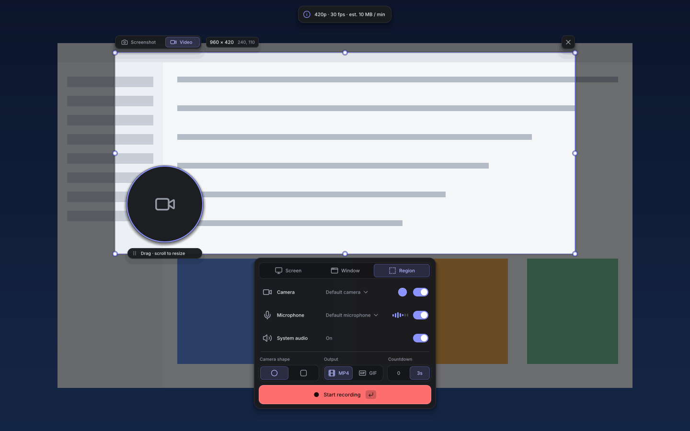

# Rustshot

**Tiny yet powerful, beautiful, open-source and cross-platform tool for
screenshots, editing and video capture.** Windows, Linux and macOS.

- **About 2 MB, one file.** A single native executable with no runtime, no
  GUI toolkit and no web view. Every pixel of the overlay is drawn by
  Rustshot's own anti-aliased renderer.
- **Zero memory when you're not capturing.** Turn the tray icon off and
  nothing runs in the background at all: **0 MB**. Rustshot replaces the
  Snipping Tool: Win+Shift+S or Print Screen starts Rustshot for the
  capture, and it quits when you're done.
  With the tray icon on, the daemon uses 2.3 MB of private memory (about
  14 MB working set), and the capture overlay on a 5120 × 1440 desktop
  under 5 MB. Measured on Windows 11, release build.
- **Smooth.** On Windows the overlay repaints only the pixels that changed,
  through GDI dirty rectangles, and draws nothing while it sits idle.
  At 3840 × 2160, drawing a selection with the pixel magnifier takes about
  2.3 ms per mouse move (0.7 ms without it). Moving an annotation takes
  under 1 ms. A 60 fps frame is 16 ms.
- **Good-looking.** Dark and light themes follow your OS, and you can pick
  any accent color. The UI is built from one set of design tokens, with
  the Inter font, Lucide icons, soft shadows and short animations.


| Light theme with a text annotation | Video mode |
|---|---|
|  |  |

<sub>Rendered by Rustshot's own preview tests over a sample window.</sub>

## Features

**Capture**
- Region, full screen, a single monitor or a window. Hover a window to
  outline it, then click to take exactly that window, menu or tooltip.
  <kbd>Tab</kbd> steps into its panels and fields.
- Resize handles, arrow-key nudging and a live `W × H` readout.
- *Freeform*: draw a lasso instead of a rectangle (<kbd>Shift</kbd>+<kbd>F</kbd>, or the
  lasso by the mode switch). Outside it the PNG is transparent (white in a
  JPG or BMP).
- Crop (<kbd>C</kbd>): a frame inside the selection, or inside the picture in the
  Edit window, where the crop can be undone or widened again later.
- A pixel magnifier shows the position and color under the pointer.
  <kbd>H</kbd> copies the color as `#rrggbb`.
- *Accept on select*: copy or save the moment you release the mouse.
- *Trim to content*: <kbd>Shift</kbd>+<kbd>A</kbd> (or click the `W × H`
  readout) cuts the uniform margins off the selection. Settings can trim
  every new region or window for you.
- Works across multiple monitors. The UI follows each display's scaling.
- On Windows, HDR displays are tone-mapped to SDR, so screenshots and
  recordings look as they do on screen instead of washed out.

**Annotate & edit**
- Pencil, line, arrow, rectangle, ellipse, marker, text, callout,
  numbered tags, pixelate, blur, invert, spotlight and magnifier.
- Text styles: sans, serif or mono font, bold, italic, underline,
  strikethrough and alignment.
- Annotations stay editable objects. Select, move, resize, restyle,
  restack and duplicate them, with snapping and unlimited undo.
- Image edits in the Edit window, all undoable and non-destructive:
  rotate, flip, resize (Lanczos-3 or area average, with a file size
  estimate) and a canvas (padding, a solid color or a soft "presentation"
  gradient, rounded corners, a drop shadow). Text stays upright when the
  picture turns.
- Right-click opens a color ring.

**Record**
- Record a region, a window or a screen to MP4 (30 or 60 fps) or GIF.
- System sound, your microphone, and a camera bubble you can drag.
- A 3-2-1 countdown, and pause, mute and discard while recording.

**Share**
- Copy to the clipboard, or save as PNG, JPEG or BMP into dated folders
  with your own file-name pattern.
- Save As, Save to Desktop, **Open with…** any app, **Share…** through the
  system's share sheet (Windows, macOS), or (on Windows) drag the thumbnail
  into another app.
- An optional border (any color, 1 to 8 px) around everything you copy,
  save, upload or pin.
- *Save at*: screen pixels, 1× (a high-DPI capture at its logical size) or
  a percent, for everything you copy, save or upload. Pins and History keep
  the full capture.
- Upload to Imgur, or to your own S3-compatible bucket (Amazon S3,
  Cloudflare R2, MinIO, …), with the link copied for you. Images and MP4
  recordings can be uploaded, and you can delete an upload later
  ([Uploads](docs/guide.md#uploads)).

**History**
- Every capture is kept for 30 days (up to 2 GB) with its annotations
  still editable.
- Search and filter your captures, then reopen one in a zoomable Edit
  window.

**OCR**
- Copy the text from any area. Rustshot uses the OCR built into Windows
  and macOS, or `tesseract` on Linux. Nothing is uploaded.
- Text mode: the toolbar's Copy text shows the words it found. Drag across
  them to select (double-click a word, triple-click a line, <kbd>Ctrl</kbd>+<kbd>A</kbd>
  all), then <kbd>Ctrl</kbd>+<kbd>C</kbd> or **Copy**; with nothing selected <kbd>Ctrl</kbd>+<kbd>C</kbd>
  copies all the text, and **Copy all** does too. <kbd>Esc</kbd> leaves Text mode
  (then <kbd>Ctrl</kbd>+<kbd>C</kbd> copies the picture as before). The Copy text hotkey
  still copies all at once (Settings › Overlay › Copy text picks the
  button's way too).
- Quick Redact (<kbd>Shift</kbd>+<kbd>R</kbd>): e-mail addresses, phone and card numbers,
  IBANs, IP addresses, URLs with tokens, keys, passwords and JWTs are
  covered with an opaque fill in the surrounding color, all in one undo
  step (Settings › Overlay › Redact style: Solid, or Blur). Long-press
  Copy text to choose which kinds.

**Pin**
- Pin a capture on top of every window. Zoom it, fade it and compare
  against it.

**Launcher**
- Choose what to capture, set a delay of 0 to 60 s, and decide what
  happens next: edit, copy, save or pin. A countdown pill shows the delay
  and is never in the capture.

**Shortcuts**
- Global hotkeys and every editor key can be remapped in Settings ›
  Shortcuts (Global, Recording, Overlay tools, Overlay actions).
- On Windows, Rustshot can take over <kbd>Win</kbd>+<kbd>Shift</kbd>+<kbd>S</kbd>
  and <kbd>Print Screen</kbd>.

Rustshot also has a Settings window, a scriptable command line and
in-app updates checked against `SHA256SUMS`.

## Install

Download from the **[latest release](https://github.com/nappsllc/rustshot/releases/latest)**
(v0.3.0 sizes shown):

| Platform | File | Size | Notes |
|---|---|---|---|
| Windows 10/11 | `rustshot-<v>-setup.exe` | 1.0 MB | Per-user installer, no admin. Start menu *Rustshot* and *Rustshot Settings*; optional desktop shortcut and start with Windows. Installing over an older version replaces its shortcuts (0.1.0 named them in lowercase). |
| Windows (portable) | `rustshot-<v>-windows-x86_64.exe` | 2.1 MB | The whole app. Run it from anywhere. |
| Windows (Store package) | `rustshot-<v>-x64.msix` | 1.1 MB | The unsigned Microsoft Store upload package. You can't install it directly; use the installer or the portable exe. |
| Debian / Ubuntu | `rustshot-<v>-amd64.deb` | 1.2 MB | `sudo apt install ./rustshot-<v>-amd64.deb` |
| Any Linux | `rustshot-<v>-x86_64.AppImage` | 2.3 MB | `chmod +x`, then run it. |
| Any Linux | `rustshot-<v>-linux-x86_64.tar.gz` | 1.4 MB | The binary and a desktop file. See `INSTALL.txt` inside. |
| Any Linux | `rustshot.flatpak` | 1.2 MB | `flatpak install --user rustshot.flatpak` |
| Any Linux | `rustshot_<v>_amd64.snap` | 9.1 MB | `sudo snap install --dangerous rustshot_<v>_amd64.snap` |
| macOS 11+ | `rustshot-<v>-macos-universal.dmg` | 2.3 MB | Universal (Apple Silicon and Intel). Drag it to Applications. |
| macOS 11+ | `rustshot-<v>-macos-universal.zip` | 1.8 MB | The same `Rustshot.app`, zipped. |

> **Unsigned builds.** Releases are not code-signed yet. On Windows,
> SmartScreen may warn on first run: choose *More info* › *Run anyway*. On
> macOS, Gatekeeper blocks the first launch ("Rustshot Not Opened"). Move
> `Rustshot.app` to Applications, try to open it once, then open **System
> Settings › Privacy & Security**, scroll down and click **Open Anyway**.
> If that button doesn't appear, run this once in Terminal and open the app
> again:
>
> ```bash
> xattr -dr com.apple.quarantine /Applications/Rustshot.app
> ```

Store and package-manager listings (Microsoft Store, winget, Mac App Store,
Homebrew, Flathub, Snap Store, AUR) are being set up. See
[docs/STORES.md](docs/STORES.md).

## Quick start

1. Run `rustshot` (or launch it from the Start menu or your app list). It
   starts in the background with a tray icon. The installers can start
   it at login.
2. Press <kbd>Win</kbd>+<kbd>Shift</kbd>+<kbd>X</kbd>. Use <kbd>⌘</kbd>
   instead of <kbd>Win</kbd> on macOS and <kbd>Super</kbd> on Linux.
3. Drag a region, or click a window.
4. Annotate it, then press <kbd>Ctrl</kbd>+<kbd>C</kbd> to copy,
   <kbd>Enter</kbd> or <kbd>Ctrl</kbd>+<kbd>S</kbd> to save, or
   <kbd>Ctrl</kbd>+<kbd>U</kbd> to upload. <kbd>Esc</kbd> cancels.

If you launch Rustshot while it is already running, the running copy
starts a capture, or opens Settings when its tray icon is hidden (or a
recording runs). With the tray icon off on Windows nothing runs in the
background: launching Rustshot (or **Rustshot Settings** in the Start
menu) opens Settings. On Linux, macOS and in the Microsoft Store build
the icon off keeps Rustshot running without it. The tray menu has
**Capture…**, **History…** and **Settings…**.

## Replace the Snipping Tool (Windows)

Windows sends <kbd>Win</kbd>+<kbd>Shift</kbd>+<kbd>S</kbd> and
<kbd>Print Screen</kbd> to the Snipping Tool, and getting rid of that is
well hidden. Rustshot does it in three steps:

1. In Rustshot, open **Settings › Capture** and turn on **Use Win+Shift+S
   and Print Screen**.
2. Open Windows **Settings › Apps › Default apps**, scroll to the bottom
   and click **Choose defaults by link type**.
3. Find **MS-SCREENCLIP** and pick **Rustshot**.

Now both keys open Rustshot, even when it isn't running: it starts for
the capture and quits afterwards. For <kbd>Print Screen</kbd>, also keep
**Settings › Accessibility › Keyboard › Use the Print screen key to open
screen capture** on (it is on by default in Windows 11).

Rustshot walks you through it: turning the option on shows **One more step
to use Win+Shift+S** with these steps and an **Open Default apps** button,
and **Settings › Capture** says under the option which app Win+Shift+S
opens now.

Windows only lets you, not an app, make that choice, which is why step 2
can't be skipped. If Win+Shift+S shows "This file does not have an app
associated with it", the Snipping Tool was uninstalled and the old choice
points nowhere: the same three steps fix it. To go back, turn the option
off in Rustshot, and Windows uses the Snipping Tool again. More detail:
[docs/guide.md](docs/guide.md#winshifts-and-print-screen-windows).

## Shortcuts

| Global | Default |
|---|---|
| Capture a region | <kbd>Win</kbd>+<kbd>Shift</kbd>+<kbd>X</kbd> |
| Capture the full screen (saved at once) | <kbd>Win</kbd>+<kbd>Shift</kbd>+<kbd>F</kbd> |
| Capture a window | <kbd>Win</kbd>+<kbd>Shift</kbd>+<kbd>E</kbd> |
| Start or stop recording | <kbd>Win</kbd>+<kbd>Shift</kbd>+<kbd>G</kbd> |
| Copy text from an area | <kbd>Win</kbd>+<kbd>Shift</kbd>+<kbd>Z</kbd> |
| Open History | <kbd>Win</kbd>+<kbd>Shift</kbd>+<kbd>H</kbd> |
| Quit Rustshot | <kbd>Ctrl</kbd>+<kbd>Alt</kbd>+<kbd>Shift</kbd>+<kbd>Q</kbd> |

| In the overlay | Keys |
|---|---|
| Select / Pencil / Line / Arrow | <kbd>V</kbd> / <kbd>P</kbd> / <kbd>L</kbd> / <kbd>A</kbd> |
| Rectangle / Ellipse / Marker / Text / Callout | <kbd>R</kbd> / <kbd>E</kbd> / <kbd>M</kbd> / <kbd>T</kbd> / <kbd>K</kbd> |
| Number / Pixelate / Blur / Invert | <kbd>N</kbd> / <kbd>X</kbd> / <kbd>B</kbd> / <kbd>I</kbd> |
| Spotlight / Magnify | <kbd>S</kbd> / <kbd>Z</kbd> |
| Stroke size − / + | <kbd>[</kbd> / <kbd>]</kbd> or the mouse wheel |
| Copy / Save / Save As / Upload | <kbd>Ctrl</kbd>+<kbd>C</kbd> / <kbd>Ctrl</kbd>+<kbd>S</kbd> / <kbd>Ctrl</kbd>+<kbd>Shift</kbd>+<kbd>S</kbd> / <kbd>Ctrl</kbd>+<kbd>U</kbd> |
| Save to Desktop / Open with… / Pin | <kbd>Ctrl</kbd>+<kbd>D</kbd> / <kbd>Ctrl</kbd>+<kbd>O</kbd> / <kbd>Ctrl</kbd>+<kbd>P</kbd> |
| Share… (Windows, macOS) | <kbd>Ctrl</kbd>+<kbd>Shift</kbd>+<kbd>E</kbd> |
| Copy text (OCR) / Copy color under pointer | <kbd>O</kbd> (or <kbd>Ctrl</kbd>+<kbd>Shift</kbd>+<kbd>C</kbd>) / <kbd>H</kbd> |
| Crop / Quick Redact / Freeform selection | <kbd>C</kbd> / <kbd>Shift</kbd>+<kbd>R</kbd> / <kbd>Shift</kbd>+<kbd>F</kbd> |
| Text mode: copy the words / select all / leave | <kbd>Ctrl</kbd>+<kbd>C</kbd> (or <kbd>Enter</kbd>) / <kbd>Ctrl</kbd>+<kbd>A</kbd> / <kbd>Esc</kbd> |
| Undo / Redo | <kbd>Ctrl</kbd>+<kbd>Z</kbd> / <kbd>Ctrl</kbd>+<kbd>Shift</kbd>+<kbd>Z</kbd> (or <kbd>Ctrl</kbd>+<kbd>Y</kbd>) |
| Delete / Duplicate selected objects | <kbd>Del</kbd> / <kbd>Ctrl</kbd>+<kbd>D</kbd> |
| Bring to front / Send to back | <kbd>Ctrl</kbd>+<kbd>]</kbd> / <kbd>Ctrl</kbd>+<kbd>[</kbd> |
| Select the whole screen / Toggle the palette | <kbd>Ctrl</kbd>+<kbd>A</kbd> / <kbd>Space</kbd> |
| Trim the selection to its content | <kbd>Shift</kbd>+<kbd>A</kbd> |
| Screenshot / Video mode | <kbd>1</kbd> / <kbd>2</kbd> |
| Bigger / Smaller UI / Auto | <kbd>Ctrl</kbd>+<kbd>=</kbd> / <kbd>Ctrl</kbd>+<kbd>-</kbd> / <kbd>Ctrl</kbd>+<kbd>0</kbd> |
| Accept / Cancel | <kbd>Enter</kbd> / <kbd>Esc</kbd> |
| Move / resize the selection | arrow keys / <kbd>Shift</kbd>+arrow keys |
| Square, circle or 45° line | hold <kbd>Shift</kbd> while drawing |

| In the Edit window | Keys |
|---|---|
| Rotate left / right | <kbd>Ctrl</kbd>+<kbd>L</kbd> / <kbd>Ctrl</kbd>+<kbd>R</kbd> |
| Flip horizontal / vertical | <kbd>Ctrl</kbd>+<kbd>Shift</kbd>+<kbd>H</kbd> / <kbd>Ctrl</kbd>+<kbd>Shift</kbd>+<kbd>V</kbd> |
| Resize… / Canvas… | <kbd>Ctrl</kbd>+<kbd>Shift</kbd>+<kbd>R</kbd> / <kbd>Ctrl</kbd>+<kbd>Shift</kbd>+<kbd>K</kbd> |
| Reset image edits | (unbound; the Image menu) |

On macOS, <kbd>⌘</kbd> works wherever <kbd>Ctrl</kbd> is listed. Every key
can be remapped in Settings › Shortcuts. The
[user guide](docs/guide.md) covers the Edit window, recording chords and
the rest.

## Command line

```bash
rustshot                          # start the background daemon (tray icon; default)
rustshot gui                      # interactive capture
rustshot gui --clip               # select, annotate, Enter copies to the clipboard
rustshot gui --accept-on-select   # drag a region: copied at once (hold Alt on release to adjust)
rustshot gui --region 800x600+100+100 --upload
rustshot full --path ~/Pictures   # whole desktop, no editor
rustshot screen -n 1 --edit       # second monitor (0-based), open the editor
rustshot full --raw > shot.png    # PNG bytes to stdout
rustshot full --delay 3000 --clip # wait 3 s, copy the whole desktop
rustshot launcher                 # the capture launcher: what, after a delay, then what
rustshot history                  # open the History window
rustshot history --list           # print captures: captured, kind, WxH, bytes, file (tab-separated)
rustshot settings                 # open the Settings window
rustshot update                   # check for a newer release
rustshot config --check           # validate config.toml
rustshot register-screenclip on   # Windows: Win+Shift+S opens Rustshot ("off" undoes it)
rustshot --help
```

Capture options: `-p/--path`, `-c/--clip`, `--raw`, `--geometry`,
`--upload`, `-d/--delay <ms>`, `-f/--filename <pattern>`,
`--region WxH+X+Y|all|screenN`, `--noedit`, `--edit`,
`--accept-on-select`, and `-n/--number` for `screen`.

## Configuration

Everything is in the **Settings** window, which is easier than editing
the file by hand. Settings are stored in `config.toml`: on Windows in
`%APPDATA%\rustshot\config.toml`, on Linux and macOS in
`~/.config/rustshot/config.toml` (or under `$XDG_CONFIG_HOME`).
`rustshot config` prints the path. A few common keys:

```toml
theme = "auto"                    # "auto", "dark" or "light"
save_path = ""                    # "" = Pictures/rustshot
filename_pattern = "%F_%H-%M"
capture_hotkey = "Shift+Meta+X"   # Meta = Win, Cmd or Super
history_days = 30
check_updates = true
```

Every key, the file-name tokens and the `[shortcuts]` table are listed in
[docs/configuration.md](docs/configuration.md).

## Privacy

No telemetry and no account. Captures leave your computer only when you
choose **Upload** (images) or **Copy link** (an MP4 recording), or turn
on *Upload recordings automatically*. They go to the destination you
set: Imgur, or your own S3-compatible bucket, whose secret access key
stays in the OS credential store. History, upload records and settings
stay on your computer.
The only automatic network request is the daemon's update check: one
anonymous call to the GitHub Releases API, at most once a day. Turn it
off with `check_updates = false`. See [PRIVACY.md](PRIVACY.md).

## Building from source

You need a current stable Rust toolchain (edition 2024). On Linux, also
install the X11 headers: `libx11-dev libxrandr-dev libxext-dev
libxfixes-dev` on Debian or Ubuntu.

```bash
cargo build --release          # target/release/rustshot(.exe)
cargo test                     # unit tests
cargo test -- --ignored        # live display / clipboard / network tests
```

The camera's background blur uses MediaPipe's Selfie Segmentation model
(Apache-2.0), converted to `assets/selfie.bin` (source and hash in
`assets/selfie.bin.txt`); it is embedded whenever that file is there.
`RUSTSHOT_NO_SELFIE=1` builds without it (macOS 12+ still blurs with
Vision). To convert the model again:

```bash
cargo run --manifest-path tools/convert-selfie/Cargo.toml -- \
    selfie_segmentation_landscape.tflite assets/selfie.bin
```

Packaging scripts for NSIS, MSIX, `.app`/dmg, deb, AppImage, Flatpak,
Snap, AUR and Homebrew live in [`packaging/`](packaging). CI builds all of
them on every push. Pushing a `vX.Y.Z` tag that matches `Cargo.toml`
publishes a GitHub Release
([`.github/workflows/release.yml`](.github/workflows/release.yml)). The
UI design boards are in
[docs/design/rustshot-ui](docs/design/rustshot-ui), and the specs and
plans are in [docs/superpowers](docs/superpowers).

## Known limitations

From the v0.3.0 release notes:

- **macOS:** the launcher, History and Edit windows are not available yet
  (and neither is Settings, which opens `config.toml` instead). The macOS
  build has not been tested on real hardware.
- **Blur performance:** a blur can take more than 4 ms per mouse move on
  machines with 2 to 4 cores, mostly on large areas at 4K.
- **X11:** a pin's opacity only takes effect when a compositor is running.
- **Linux OCR:** needs `tesseract` (for example `apt install
  tesseract-ocr`).
- **Unsigned builds:** see the note under [Install](#install).
- **Settings from 0.1.x:** your config may still bind Win+Shift+R and
  Win+Shift+T for Record and Copy text, which some Windows builds
  reserve. Rebind them in Settings › Shortcuts › Global. The defaults are now
  Win+Shift+G and Win+Shift+Z.

The [platform notes](docs/guide.md#platform-notes) cover Wayland and
mixed-DPI setups.

## License

Rustshot is free software under the **GNU General Public License v3.0
only** ([LICENSE](LICENSE)). Its behavior and UI are modeled on Flameshot
(also GPL-3.0). It bundles the Inter font (SIL OFL 1.1) and Lucide icons
(ISC); see [THIRD_PARTY_NOTICES.md](THIRD_PARTY_NOTICES.md).
